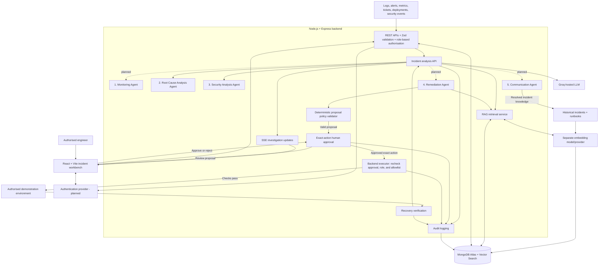

# AegisOps

**Detect. Diagnose. Defend. Recover.**

An AI-powered incident investigation and response platform proposed and partially implemented for the **HCLTech AI Future Ready FullStack Web Engineer Hackathon**.

**Use case:** Autonomous Incident War Room Agent

**Current status:** Partial implementation. RCA/Security analysis and review UI, MongoDB-backed knowledge/RAG, and a human-reviewed Remediation module with safety checks and sample-runbook validation are implemented. Shared orchestration, monitoring ingestion, authenticated approval, execution, communications, and deployment remain planned.

## 1. Overview

AegisOps is designed as an incident command centre where engineers can review operational signals, investigate probable causes, assess security concerns, and evaluate recovery actions in one place.

The incident-analysis API connects MongoDB-backed Knowledge/RAG retrieval with the RCA/Security agents. The Remediation module remains a separately reviewed workflow; a broader five-agent orchestrator, monitoring ingestion, communication, and authenticated approval remain planned.

## 2. Problem statement

Production incidents scatter evidence across application and infrastructure logs, monitoring alerts, performance metrics, incident tickets, deployment histories, security events, historical reports, and operational runbooks.

Engineers must manually collect and correlate these signals, investigate the failure, assess threats, choose remediation, communicate progress, and document the incident. This fragmentation increases investigation time, delays recovery, and adds operational overhead. No measurable recovery-time improvement has been established for AegisOps.

## 3. Proposed solution

**Planned:** AegisOps will ingest operational signals, correlate related events, and coordinate agents that investigate causes, retrieve historical context, recommend corrective and preventive actions, and draft communications.

Findings will distinguish confirmed observations from hypotheses, with supporting evidence and missing information visible to reviewers. RAG will provide relevant past incidents and runbooks; a similar historical incident will inform an investigation without proving that its cause applies again.

The design follows a **human-in-the-loop approach**. Operational changes will require explicit human authorisation, deterministic backend policy validation, and an allowlisted executor. Controlled execution, if implemented, will target an authorised demonstration environment. Resolved incidents will become reusable knowledge, with an auditable history of investigations and decisions.

## 4. Key features

RCA/Security investigation, Knowledge/RAG retrieval, and the Remediation review UI are implemented in this checkout; other listed features remain planned.

| Feature | Intended behaviour | Status |
| --- | --- |
| Unified intake | Receive alerts, tickets, logs, deployment events, and monitoring signals. | Planned |
| Event correlation | Group evidence by service, timestamp, and trace identifier; identify affected services. | Planned |
| Evidence-based investigation | Present probable causes, security indicators, and evidence gaps with source references. | RCA/Security module implemented; broader correlation planned |
| Historical retrieval | Search historical incidents and runbooks through MongoDB-backed keyword retrieval, with optional semantic backends. | Implemented; semantic search requires provider/index configuration |
| Remediation recommendations | Generate safety-checked steps, validate against runbooks, and record engineer review. | Implemented; sample runbook data and temporary local review only |
| Human approval | Let an authorised engineer approve or reject the exact executable proposal. | Planned |
| Live investigation view | Show agent findings and source evidence in the dashboard. | RCA/Security panels implemented; War Room/SSE planned |
| Communications and learning | Draft stakeholder updates, reports, and reusable knowledge articles. | Planned |
| Audit history | Record evidence, findings, proposals, decisions, execution results, and observed outcomes. | Planned |

## 5. Multi-agent architecture

The shared Express API now accepts incidents at `/api/analysis`, retrieves historical knowledge from the connected MongoDB database, and passes those results into RCA/Security. The Remediation API remains a separate human-reviewed workflow. Monitoring, Communication, authenticated approval, and shared multi-agent orchestration remain planned.

| Agent | Responsibilities | Outputs and boundaries |
| --- | --- | --- |
| **1. Monitoring Agent** | Process logs, alerts, and metrics; correlate service names, timestamps, and trace identifiers; detect anomalies and affected services. | Structured incident summaries with evidence references. Deterministic logic handles straightforward thresholds and grouping. |
| **2. Root Cause Analysis Agent** | Analyze operational evidence and supplied historical search results. | Implemented: probable cause hypotheses, validated source IDs, evidence-support factors, and validation steps. |
| **3. Security Analysis Agent** | Inspect authentication and request evidence for suspicious patterns and service degradation. | Implemented: deterministic evidence-linked findings; indicators are not treated as confirmed attacks. |
| **4. Remediation Agent** | Interpret RCA findings, propose diagnostic and recovery steps, apply deterministic safety checks, compare proposals with available runbook instructions, and record engineer review. | Implemented with deterministic fallback and optional Groq; sample runbooks are simulated and no operational actions are executed. |
| **5. Communication Agent** | Draft technical summaries, stakeholder updates, progress explanations, post-incident reports, and knowledge articles. | Planned; communications must reflect verified incident status and observed outcomes. |

Groq-hosted reasoning is optionally integrated in the RCA/Security and Remediation agents when a backend key is configured; they fall back to deterministic behavior when unavailable. The incident-analysis API retrieves historical context from MongoDB and passes it to RCA/Security without treating it as current evidence. The evidence-support score is a heuristic, not a calibrated probability.

## 6. System architecture diagram

This is the **proposed platform architecture**. The RCA/Security agents and review panels exist; the shared services and remaining integrations are **Planned**.



Rejected, invalid, or unauthorised actions must stop without execution. The executor must enforce approval and policy checks independently of the model's recommendations.

## 7. End-to-end incident workflow

The end-to-end workflow remains **Planned**; the RCA/Security agent calls and review panels are implemented independently.

1. **Incident intake:** Receive an alert, ticket, application log, deployment event, or monitoring signal.
2. **Event correlation:** The Monitoring Agent groups related events and identifies affected services.
3. **Investigation:** The RCA Agent examines technical failure mechanisms and the Security Agent checks supplied evidence for risk indicators.
4. **Historical knowledge retrieval:** Search similar incidents and runbooks using semantic retrieval to inform the investigation.
5. **Root cause findings:** Present probable causes, supporting evidence, alternative hypotheses, security concerns, and missing information.
6. **Remediation recommendation:** Generate corrective actions, risks, and verification steps. Validate executable proposals against backend policy.
7. **Human approval:** An authorised engineer reviews the exact action and approves or rejects it. Rejection stops execution.
8. **Controlled execution:** If implemented, the executor rechecks authorisation, approval, and policy, then performs only allowlisted actions in an authorised demo environment.
9. **Recovery verification:** Check service health and record the observed outcome, including failed or inconclusive recovery.
10. **Incident documentation:** Generate summaries, post-incident reports, and reusable knowledge articles grounded in verified findings and outcomes.

## 8. Technology stack

The table distinguishes this module's implemented dependencies from the wider platform proposal.

| Layer | Proposed technology and purpose | Status |
| --- | --- | --- |
| Frontend | React.js, Vite, Mermaid, and Lucide React for investigation and review panels | Incident workbench, RCA/Security panels, and Remediation review UI implemented |
| Backend | Node.js ES modules, Express REST API, and MongoDB persistence for incident knowledge and remediation plans | `/api/analysis`, Knowledge/RAG, and Remediation APIs implemented |
| Live updates | Server-Sent Events (SSE) for investigation progress | Planned |
| Validation | Zod for Groq RCA output validation and evidence-reference checks | Implemented for this module |
| AI reasoning | Groq-hosted LLM and structured RCA output | Optional RCA integration; live API behavior requires credentials |
| Agent coordination | Custom orchestration | Planned |
| Embeddings | Separate embedding model/provider for semantic retrieval | Planned; provider/model to be selected |
| Data and retrieval | MongoDB-backed keyword retrieval by default; Atlas Vector Search and local-vector retrieval are optional | Implemented; vector retrieval requires corresponding configuration/index/model |
| Authentication | Provider to be selected by the team | Planned |
| Security controls | Deterministic remediation safety checks and recorded local engineer review | Partial; authentication, verified identity, execution allowlist, and audit integration remain planned |
| Frontend hosting | Vercel | Planned |
| Backend hosting | Render | Planned |
| Database hosting | MongoDB Atlas | Planned |

## 9. Example incident scenario

**Illustrative scenario only. The full workflow is not an implemented or end-to-end tested feature.**

A payment application starts returning HTTP 500 errors shortly after a deployment. Evidence includes a recent deployment event, increasing database connection utilisation, connection pool exhaustion errors, an increasing payment API failure rate, and a critical service health alert.

The proposed workflow would correlate those events and identify connection exhaustion as the immediate failure mechanism supported by the supplied evidence. The RCA Agent would investigate whether the deployment contributed, retrieve similar incidents, and compare competing explanations. Temporal proximity alone would not confirm deployment causation.

The Security Analysis component would inspect suspicious activity and evidence gaps. The Remediation Agent might propose rolling back to a previously verified version, with risks and verification steps, subject to policy validation and human approval.

If controlled execution is implemented, the demo could simulate the approved rollback and verify resulting service health. The Communication Agent would produce a stakeholder update and post-incident summary reporting the observed result, including unresolved symptoms or inconclusive recovery.

## 10. Functional requirements coverage

This maps design intent to requirements and notes the current RCA/Security module coverage.

| ID | Requirement | Planned approach | Current status |
| --- | --- | --- | --- |
| FR-01 | Incident Intake | Validated backend intake of operational signals | Planned |
| FR-02 | Event Correlation | Monitoring Agent with deterministic grouping and thresholds | Planned |
| FR-03 | Root Cause Analysis | Evidence-linked hypotheses and security investigation | RCA/Security module implemented; orchestrator integration planned |
| FR-04 | Multi-Agent Investigation | Orchestrator coordinating five specialised agents | Planned |
| FR-05 | Knowledge Retrieval | MongoDB incident/runbook corpus, keyword search, and optional semantic retrieval | Implemented; semantic backends require configuration |
| FR-06 | Remediation Recommendation | Structured proposals with risks and verification steps | Planned |
| FR-07 | Stakeholder Communication | Communication Agent grounded in verified status | Planned |
| FR-08 | Human Approval Workflow | Backend role checks, exact-action approval, and policy enforcement | Planned |
| FR-09 | Auditability | Persistent investigation, decision, and action records | Planned |
| FR-10 | Incident Learning | Convert resolved incidents into retrieval knowledge | Planned |

## 11. Repository structure

Key module files, excluding dependencies and generated output:

```text
hcl-hackathon/
|-- .gitignore
|-- backend/
|   |-- src/agents/{rcaAgent,securityAgent}.js
|   |-- src/utils/incidentEvidence.js
|   |-- tests/
|   `-- scripts/evaluateRca.js
|-- docs/
|   |-- ALOK_RCA_SECURITY_EVALUATION.md
|   |-- api-contracts.md
|   `-- architecture.md
|-- frontend/
|   `-- src/{pages,components}/
`-- README.md
```

The backend and frontend have independent package manifests and lockfiles. Database migrations and shared orchestration are not implemented.

## 12. Prerequisites

To run and test the implemented module, install Node.js and npm. A Mermaid-capable Markdown viewer can display the proposed architecture diagram.

**Additional integration prerequisites:**

- Node.js and a package manager; supported versions and package manager are not yet defined.
- MongoDB connection string for knowledge retrieval and remediation persistence.
- Optional Groq credentials and a selected reasoning model for live RCA and Remediation generation.
- Optional Atlas Vector Search index or local embedding model when enabling semantic retrieval.
- An authorised demonstration environment if controlled execution is implemented.

## 13. Installation and local setup

Install the independently managed frontend and backend dependencies from the repository root:

```powershell
Push-Location .\backend
npm install
Pop-Location

Push-Location .\frontend
npm install
Pop-Location
```

Copy `backend/.env.example` to `backend/.env`, then set `MONGODB_URI` and, optionally, `GROQ_API_KEY`. The backend loads `.env` automatically. Keep real credentials out of source control and do not place provider keys in frontend variables.

## 14. Environment variables

The backend template is `backend/.env.example`. The RCA key is optional; do not expose it in frontend configuration.

| Variable | Purpose and default |
| --- | --- |
| `GROQ_API_KEY` | Optional server-side Groq credential; absent key selects explicit local fallback |
| `GROQ_MODEL` | Optional model override; defaults to `llama-3.3-70b-versatile` |
| `GROQ_TIMEOUT_MS` | Groq request timeout; defaults to `15000` |
| `MONGODB_URI` | MongoDB connection string for knowledge retrieval and saved Remediation plans |
| `NODE_ENV` | Must be `development` or `test` to run the opt-in synthetic knowledge seeder |
| `KNOWLEDGE_SEARCH_BACKEND` | `keyword` by default; set `atlas` or `local-vector` to enable configured semantic retrieval |
| `KNOWLEDGE_SEARCH_FALLBACK` | Retrieval fallback mode for optional semantic backends |
| `SECURITY_FAILED_LOGIN_THRESHOLD` | Repeated failure threshold; defaults to `5` |
| `SECURITY_AUTH_SPIKE_THRESHOLD` | Request spike threshold; defaults to `20` |
| `SECURITY_EVENT_WINDOW_MS` | Security event window; defaults to `300000` |

The existing `.gitignore` excludes `.env` and `.env.*` while allowing `.env.example`. Keep provider secrets server-side and outside version control.

## 15. Running the application

Run the backend API and the frontend development server in separate terminals:

```powershell
Push-Location .\frontend
npm run dev
Pop-Location
```

```powershell
Push-Location .\backend
npm run dev
Pop-Location
```

The UI posts the editable incident JSON to `POST /api/analysis`. MongoDB knowledge retrieval uses keyword search by default; when MongoDB is unavailable, analysis continues without history and reports that in the existing summary/reasoning fields. Groq analysis is optional and falls back to deterministic RCA/Security behavior when no key is configured. The health endpoint reports connection/configuration status without exposing secrets.

Knowledge seeding is opt-in and synthetic-only. From `backend`, run `npm run seed:knowledge` for a dry-run preview. Verify the database is non-production, then use `npm run seed:knowledge -- --apply` to insert the sample records. Seeding requires `NODE_ENV=development` or `test`; it never runs during server startup.

## 16. Testing

Run the backend tests and deterministic fixture evaluation with:

```powershell
Push-Location .\backend
npm test
npm run evaluate:rca
Pop-Location
```

The current deterministic suite covers five synthetic RCA categories, evidence provenance, Groq response validation with a stub, and Security Agent cases. Current results are in [docs/ALOK_RCA_SECURITY_EVALUATION.md](./docs/ALOK_RCA_SECURITY_EVALUATION.md); they are not live-LLM or production accuracy results. Live Groq evaluation is opt-in with `npm run evaluate:rca -- --live` and a configured backend key.

## 17. Security and human approval model

The RCA and Security module's source-reference validation, response-schema validation, and rule-based findings are implemented. The following platform controls remain planned:

- **Authentication:** An authentication provider and role model remain to be selected and implemented.
- **Backend authorisation:** Server-side roles govern sensitive operations; UI controls alone cannot grant permission.
- **Exact-action approval:** An authorised engineer reviews the action, target, parameters, risks, and verification steps. A changed proposal requires fresh approval.
- **Deterministic policy validation:** A separate backend validator checks executable proposals against server-side allowlists and permitted demo targets. Model output cannot grant execution permission.
- **Controlled execution:** The backend executor rechecks permissions, approval, and policy before acting in the authorised demo environment. Agents cannot directly run arbitrary commands.
- **Auditability:** Record evidence, hypotheses, proposals, approval/rejection decisions, attempted actions, and observed outcomes.
- **Evidence-grounded reporting:** Label security indicators according to evidence and report recovery only when verification supports it.
- **Secret handling:** Keep privileged credentials on the backend and outside version control.

Autonomous repair of real production environments is not an implemented capability or a claim of this project.

## 18. Current implementation status

| Area | Status | Repository evidence |
| --- | --- | --- |
| Documentation | Present | This README describes the proposal and known gaps |
| Ignore configuration | Present | `.gitignore` covers dependencies, builds, logs, and environment files |
| Frontend/backend | Partial | Incident submission UI, `/api/analysis`, MongoDB-backed knowledge retrieval, RCA/Security UI, and Remediation UI/API are integrated; broader orchestration remains planned |
| RCA and Security | Implemented | Evidence-aware RCA fallback/optional Groq and deterministic security findings |
| Monitoring, communication, orchestration | Planned | These modules are not integrated into a shared workflow |
| Knowledge/RAG | Implemented | MongoDB knowledge module and retrieval evaluation exist; configure credentials/index for live use |
| Remediation | Implemented with demo limitations | Safety checks, sample-runbook validation, review API/UI; requires MongoDB for persistence |
| Authentication, external approval, execution, audit | Planned | Local reviewer labels are not verified identities; no production action executor exists |
| Module tests/evaluation | Implemented | Focused tests and five labeled synthetic RCA cases |
| Deployment | Planned | No deployment configuration |

The frontend and backend can be started locally. Remediation plan persistence requires `MONGODB_URI`; sample runbooks and the local review adapter are demo-only. The complete orchestrated incident-management platform is not yet available end to end.

## 19. Future enhancements

The next roadmap steps are to expand the incident-analysis API into shared workflow orchestration, connect authenticated approval and auditable recovery verification, then add monitoring ingestion, communication, and incident learning.

Potential later enhancements, subject to scope confirmation, include additional operational connectors, broader incident evaluation datasets, retrieval relevance evaluation, and richer investigation history. Performance claims should follow reproducible experiments.

## 20. Team and acknowledgements

**Team:** To be confirmed. No contributor names or roles have been supplied.

**Hackathon:** HCLTech AI Future Ready FullStack Web Engineer Hackathon.

The proposed wider platform uses Node.js, Express, MongoDB Atlas Vector Search, and Groq; the RCA/Security frontend uses React, Vite, Lucide React, and CSS. Remaining hosting and authentication choices are planned. Inclusion does not imply sponsorship or endorsement.

## 21. Information to confirm

- Team name, members, and roles.
- Final source layout, supported runtime versions, package manager, and package scripts.
- Groq reasoning model and embedding provider/model, including vector dimensions.
- Database schema, authentication roles, environment variable names, and setup procedure.
- Demo inputs, permitted remediation actions, execution targets, and verification criteria.
- Test tooling, evaluation results, deployment configuration, and any future public demo URL.

Update these details from repository evidence as implementation progresses.
