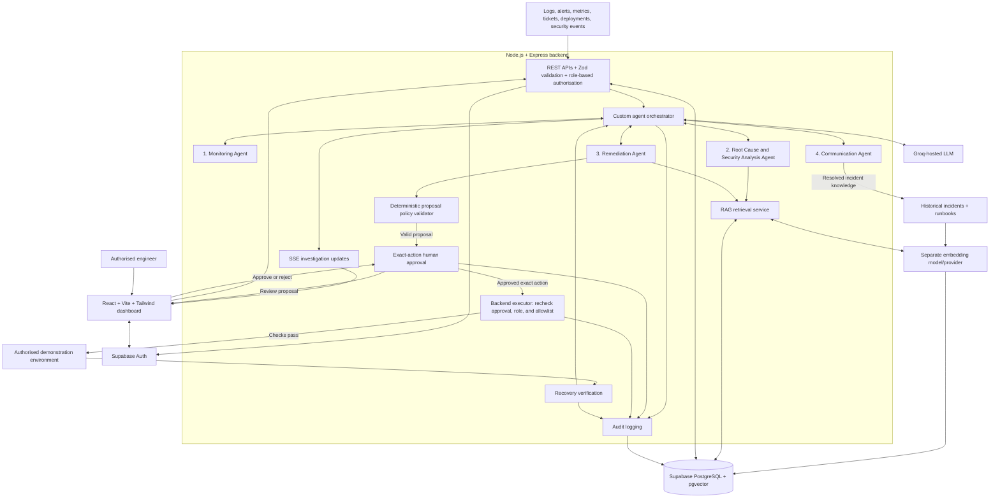

# AegisOps

**Detect. Diagnose. Defend. Recover.**

An AI-powered incident investigation and response platform proposed for the **HCLTech AI Future Ready FullStack Web Engineer Hackathon**.

**Use case:** Autonomous Incident War Room Agent

**Current status:** Planning and documentation. This repository contains only `README.md` and `.gitignore`. No application source, dependencies, schema, or tests are present. All application capabilities described below are **Planned**.

## 1. Overview

AegisOps is designed as an incident command centre where engineers can review operational signals, investigate probable causes, assess security concerns, and evaluate recovery actions in one place.

Four specialised agents will collaborate through a backend orchestration layer. Retrieval-Augmented Generation (RAG) will supply historical incidents and runbooks, while human approval will govern executable remediation. Investigations will connect recommendations to evidence and record engineers' decisions.

## 2. Problem statement

Production incidents scatter evidence across application and infrastructure logs, monitoring alerts, performance metrics, incident tickets, deployment histories, security events, historical reports, and operational runbooks.

Engineers must manually collect and correlate these signals, investigate the failure, assess threats, choose remediation, communicate progress, and document the incident. This fragmentation increases investigation time, delays recovery, and adds operational overhead. No measurable recovery-time improvement has been established for AegisOps.

## 3. Proposed solution

**Planned:** AegisOps will ingest operational signals, correlate related events, and coordinate agents that investigate causes, retrieve historical context, recommend corrective and preventive actions, and draft communications.

Findings will distinguish confirmed observations from hypotheses, with supporting evidence and missing information visible to reviewers. RAG will provide relevant past incidents and runbooks; a similar historical incident will inform an investigation without proving that its cause applies again.

The design follows a **human-in-the-loop approach**. Operational changes will require explicit human authorisation, deterministic backend policy validation, and an allowlisted executor. Controlled execution, if implemented, will target an authorised demonstration environment. Resolved incidents will become reusable knowledge, with an auditable history of investigations and decisions.

## 4. Key features

All application features are **Planned**.

| Feature | Intended behaviour |
| --- | --- |
| Unified intake | Receive alerts, tickets, logs, deployment events, and monitoring signals. |
| Event correlation | Group evidence by service, timestamp, and trace identifier; identify affected services. |
| Evidence-based investigation | Present probable causes, competing hypotheses, security indicators, and evidence gaps. |
| Historical retrieval | Search incident reports and runbooks with embeddings and pgvector. |
| Remediation recommendations | Present containment, recovery, prevention, risks, and verification steps. |
| Human approval | Let an authorised engineer approve or reject the exact executable proposal. |
| Live investigation view | Show a dashboard, timeline, RCA evidence viewer, approvals, and history with SSE updates. |
| Communications and learning | Draft stakeholder updates, reports, and reusable knowledge articles. |
| Audit history | Record evidence, findings, proposals, decisions, execution results, and observed outcomes. |

## 5. Multi-agent architecture

**Planned:** A custom backend orchestrator will coordinate four agents using structured inputs and outputs. Straightforward thresholds and event grouping will use deterministic backend logic rather than unnecessary LLM calls.

| Agent | Responsibilities | Outputs and boundaries |
| --- | --- | --- |
| **1. Monitoring Agent** | Process logs, alerts, and metrics; correlate service names, timestamps, and trace identifiers; detect anomalies and affected services. | Structured incident summaries with evidence references. Deterministic logic handles straightforward thresholds and grouping. |
| **2. Root Cause & Security Analysis Agent** | Construct timelines, retrieve similar incidents through RAG, compare root-cause hypotheses, and inspect possible security indicators. | Findings distinguish observations from hypotheses, cite supporting evidence, and identify security concerns and missing information. |
| **3. Remediation Agent** | Interpret RCA findings, retrieve successful recovery procedures, and propose containment, recovery, prevention, operational risks, and verification steps. | Structured proposals for human review. No direct arbitrary command execution or unauthorised production changes. A separate deterministic backend policy validator inspects executable actions. |
| **4. Communication Agent** | Draft technical summaries, stakeholder updates, progress explanations, post-incident reports, and knowledge articles. | Communications reflect verified incident status and observed recovery outcomes; they must not invent successful recovery. |

Groq-hosted LLM reasoning and generation are planned. A separate embedding model/provider will support retrieval; its selection remains open. Any future model-generated confidence scores must not be presented as calibrated probabilities without validation.

## 6. System architecture diagram

This is the **proposed architecture**. All components and connections are **Planned**.



Rejected, invalid, or unauthorised actions must stop without execution. The executor must enforce approval and policy checks independently of the model's recommendations.

## 7. End-to-end incident workflow

Each step is **Planned**.

1. **Incident intake:** Receive an alert, ticket, application log, deployment event, or monitoring signal.
2. **Event correlation:** The Monitoring Agent groups related events and identifies affected services.
3. **Investigation:** The RCA & Security Analysis Agent examines technical failure mechanisms and possible security threats.
4. **Historical knowledge retrieval:** Search similar incidents and runbooks using semantic retrieval to inform the investigation.
5. **Root cause findings:** Present probable causes, supporting evidence, alternative hypotheses, security concerns, and missing information.
6. **Remediation recommendation:** Generate corrective actions, risks, and verification steps. Validate executable proposals against backend policy.
7. **Human approval:** An authorised engineer reviews the exact action and approves or rejects it. Rejection stops execution.
8. **Controlled execution:** If implemented, the executor rechecks authorisation, approval, and policy, then performs only allowlisted actions in an authorised demo environment.
9. **Recovery verification:** Check service health and record the observed outcome, including failed or inconclusive recovery.
10. **Incident documentation:** Generate summaries, post-incident reports, and reusable knowledge articles grounded in verified findings and outcomes.

## 8. Technology stack

No runtime technology below is implemented. A Node-oriented `.gitignore` does not establish an installed application stack.

| Layer | Proposed technology and purpose | Status |
| --- | --- | --- |
| Frontend | React.js, Vite, Tailwind CSS for dashboard, timeline, evidence, approvals, and history | Planned |
| Backend | Node.js and Express.js for REST APIs and orchestration | Planned |
| Live updates | Server-Sent Events (SSE) for investigation progress | Planned |
| Validation | Zod for request and response validation | Planned |
| AI reasoning | Groq-hosted LLM and structured outputs | Planned; model to be selected |
| Agent coordination | Custom orchestration | Planned |
| Embeddings | Separate embedding model/provider for semantic retrieval | Planned; provider/model to be selected |
| Data and retrieval | Supabase PostgreSQL and pgvector for data and vector search | Planned |
| Authentication | Supabase Auth | Planned |
| Security controls | Backend role checks, human approval, remediation allowlist, audit logging | Planned |
| Frontend hosting | Vercel | Planned |
| Backend hosting | Render | Planned |
| Database/auth hosting | Supabase | Planned |

## 9. Example incident scenario

**Illustrative scenario only. This is not an implemented or successfully tested feature.**

A payment application starts returning HTTP 500 errors shortly after a deployment. Evidence includes a recent deployment event, increasing database connection utilisation, connection pool exhaustion errors, an increasing payment API failure rate, and a critical service health alert.

The proposed workflow would correlate those events and identify connection exhaustion as the immediate failure mechanism supported by the supplied evidence. The RCA Agent would investigate whether the deployment contributed, retrieve similar incidents, and compare competing explanations. Temporal proximity alone would not confirm deployment causation.

The Security Analysis component would inspect suspicious activity and evidence gaps. The Remediation Agent might propose rolling back to a previously verified version, with risks and verification steps, subject to policy validation and human approval.

If controlled execution is implemented, the demo could simulate the approved rollback and verify resulting service health. The Communication Agent would produce a stakeholder update and post-incident summary reporting the observed result, including unresolved symptoms or inconclusive recovery.

## 10. Functional requirements coverage

This maps design intent to requirements, not delivered functionality.

| ID | Requirement | Planned approach | Current status |
| --- | --- | --- | --- |
| FR-01 | Incident Intake | Validated backend intake of operational signals | Planned |
| FR-02 | Event Correlation | Monitoring Agent with deterministic grouping and thresholds | Planned |
| FR-03 | Root Cause Analysis | Evidence-linked hypotheses and security investigation | Planned |
| FR-04 | Multi-Agent Investigation | Orchestrator coordinating four specialised agents | Planned |
| FR-05 | Knowledge Retrieval | Embeddings, incident/runbook corpus, and pgvector search | Planned |
| FR-06 | Remediation Recommendation | Structured proposals with risks and verification steps | Planned |
| FR-07 | Stakeholder Communication | Communication Agent grounded in verified status | Planned |
| FR-08 | Human Approval Workflow | Backend role checks, exact-action approval, and policy enforcement | Planned |
| FR-09 | Auditability | Persistent investigation, decision, and action records | Planned |
| FR-10 | Incident Learning | Convert resolved incidents into retrieval knowledge | Planned |

## 11. Repository structure

Actual contents, excluding Git internals:

```text
hcl-hackathon/
|-- .gitignore
`-- README.md
```

This directory is the Git repository root inside the enclosing workspace. No frontend/backend directories, package manifests, lockfiles, migrations, environment templates, or test files exist. The source layout remains to be decided.

## 12. Prerequisites

For this documentation-only checkout, use Git and a text editor. A Mermaid-capable Markdown viewer can display the diagram.

**Planned application prerequisites:**

- Node.js and a package manager; supported versions and package manager are not yet defined.
- A Supabase project for PostgreSQL, pgvector, and authentication.
- Groq credentials and a selected reasoning model.
- Access to the separately selected embedding model/provider.
- An authorised demonstration environment if controlled execution is implemented.

## 13. Installation and local setup

There is no installable application yet. From the existing repository root, inspect the checkout with:

```sh
git status --short
git ls-files
```

Open `README.md` in your editor or GitHub. No dependency installation or database setup is currently available.

**Pending implementation:** package installation commands, source directories, schema/migrations, pgvector configuration, authentication setup, and demonstration data. These must be documented from the eventual repository files and scripts before being presented as runnable instructions.

## 14. Environment variables

No environment variable names are defined in source, and no `.env.example` exists. Exact names and values cannot yet be documented.

| Planned configuration | Information still needed |
| --- | --- |
| Supabase database and authentication | Variable names, connection settings, and frontend/backend scope |
| Groq | Credential variable names and reasoning model |
| Embedding provider | Provider, credential names, model, and vector dimensions |
| Application runtime | Ports, allowed origins, and frontend/backend connection settings |
| Controlled execution | Permitted demo targets, allowlisted actions, and policy settings |

The existing `.gitignore` excludes `.env` and `.env.*` while allowing `.env.example`. Add a documented placeholder template when configuration is implemented. Keep privileged database credentials and AI provider secrets server-side and outside version control; do not expose them through frontend configuration.

## 15. Running the application

**Not available yet.** There are no package manifests, start scripts, services, or entry points. No runnable application or deployed demo URL is available in this repository.

Frontend/backend start commands, local URLs, database preparation, and demo execution instructions must be added once implementation exists.

## 16. Testing

No test framework, scripts, fixtures, or application tests are present. No application test results, performance benchmarks, or recovery-time measurements are available.

**Planned validation:**

- Intake validation and deterministic correlation against known event fixtures.
- Structured agent outputs, evidence references, and observation/hypothesis separation.
- Retrieval relevance against labelled historical incidents and runbooks.
- Authorisation and approval enforcement, including rejected, altered, and non-allowlisted actions.
- Controlled execution and verification for successful, failed, and inconclusive demo outcomes.
- SSE progress, persistent audit records, and communications reflecting verified status.
- An end-to-end payment incident demonstration with documented inputs and expected observations.

Executable test commands and results will be documented when tests are implemented.

## 17. Security and human approval model

All controls below are **Planned**; enforcement code is absent.

- **Authentication:** Supabase Auth establishes identity.
- **Backend authorisation:** Server-side roles govern sensitive operations; UI controls alone cannot grant permission.
- **Exact-action approval:** An authorised engineer reviews the action, target, parameters, risks, and verification steps. A changed proposal requires fresh approval.
- **Deterministic policy validation:** A separate backend validator checks executable proposals against server-side allowlists and permitted demo targets. Model output cannot grant execution permission.
- **Controlled execution:** The backend executor rechecks permissions, approval, and policy before acting in the authorised demo environment. Agents cannot directly run arbitrary commands.
- **Auditability:** Record evidence, hypotheses, proposals, approval/rejection decisions, attempted actions, and observed outcomes.
- **Evidence-grounded reporting:** Label security indicators according to evidence and report recovery only when verification supports it.
- **Secret handling:** Keep privileged credentials on the backend and outside version control.

Autonomous repair of real production environments is not an implemented capability or a claim of this project.

## 18. Current implementation status

| Area | Status | Repository evidence |
| --- | --- | --- |
| Documentation | Present | This README describes the proposal and known gaps |
| Ignore configuration | Present | `.gitignore` covers dependencies, builds, logs, and environment files |
| Frontend/backend | Planned | No source, entry points, or package manifests |
| Four-agent workflow | Planned | No agents, orchestrator, or model integration |
| Database, authentication, RAG | Planned | No schema, migrations, provider configuration, or retrieval code |
| Approval, policy, execution, audit | Planned | No implementation |
| Tests and deployment | Planned | No tests or deployment configuration |

No partially implemented application features were found. This repository currently documents a proposal rather than a runnable prototype.

## 19. Future enhancements

The initial roadmap is to implement validated intake and deterministic correlation, build the dashboard and orchestrator, connect evidence-grounded investigation with RAG, then add remediation proposals, approvals, demo execution, recovery verification, and incident learning.

Potential later enhancements, subject to scope confirmation, include additional operational connectors, broader incident evaluation datasets, retrieval relevance evaluation, and richer investigation history. Performance claims should follow reproducible experiments.

## 20. Team and acknowledgements

**Team:** To be confirmed. No contributor names or roles have been supplied.

**Hackathon:** HCLTech AI Future Ready FullStack Web Engineer Hackathon.

The proposed design names React, Vite, Tailwind CSS, Node.js, Express, Zod, Groq, Supabase, PostgreSQL, pgvector, Vercel, and Render as intended technologies and services. Inclusion does not imply implemented integrations, sponsorship, or endorsement.

## 21. Information to confirm

- Team name, members, and roles.
- Final source layout, supported runtime versions, package manager, and package scripts.
- Groq reasoning model and embedding provider/model, including vector dimensions.
- Database schema, authentication roles, environment variable names, and setup procedure.
- Demo inputs, permitted remediation actions, execution targets, and verification criteria.
- Test tooling, evaluation results, deployment configuration, and any future public demo URL.

Update these details from repository evidence as implementation progresses.
